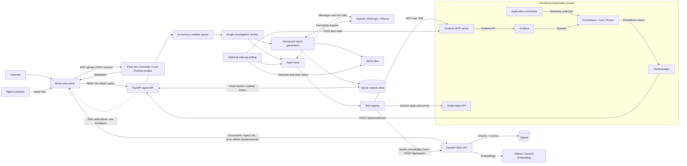
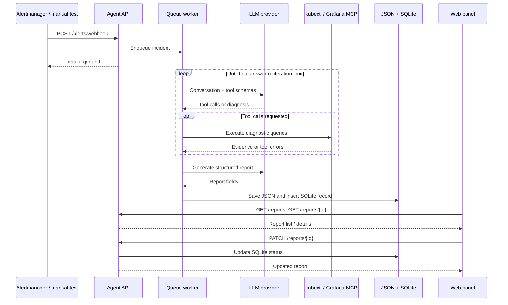
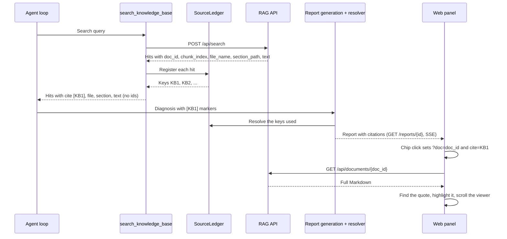

# Architecture and incident flow

This document describes the current implementation of IDAR: a system that
investigates cloud-native incidents and presents diagnostic reports to an operator.
The agent gathers evidence and recommends actions; it does not automatically
change the infrastructure.

For image builds and deployment configuration, see [CONTAINERS.md](CONTAINERS.md).
For manual and automated tests in PowerShell and Bash, see [TESTING.md](TESTING.md).
For the example monitoring stack, see the
[infrastructure README](../example-infrastructure/README.md).

## Components

| Component | Responsibility | Main files |
| --- | --- | --- |
| Web panel | React UI for incident lists, report details with their documentation citations, status changes, document preparation, and browsing the knowledge base; served by Nginx in Docker | `client/src/pages/`, `client/src/lib/api.ts`, `client/src/lib/knowledgeBase.ts` |
| Document converter | Independent Flask service converting PDFs to Markdown with local Docling models | `doc-converter/doc_converter/` |
| RAG knowledge base | FastAPI service that ingests Markdown documentation (section-aware chunking + embeddings) into Qdrant and serves semantic search with provenance for the agents; it also keeps each document's Markdown and lists, returns, and deletes documents for the panel | `server/app/` |
| Agent API | FastAPI application receiving Alertmanager webhooks and serving reports | `agent-core/webhook_server.py` |
| Investigation worker | Processes an in-memory queue, one incident at a time | `agent-core/webhook_server.py` |
| Agent loop | Repeatedly asks an LLM for tool calls or a final diagnosis, subject to an iteration budget | `agent-core/agent_core/agent/loop.py` |
| Provider adapters | Common interface for OpenAI, Anthropic, and Ollama | `agent-core/agent_core/llm/`, `agent-core/agent_core/config.py` |
| Tool registry | Common interface for local kubectl tools and remote MCP tools | `agent-core/agent_core/tools/` |
| Citation resolver | Gives each knowledge-base search hit a short `[KBn]` key for one investigation, and maps the keys a report uses back to documents and passages | `agent-core/agent_core/citations.py` |
| Grafana MCP server | Exposes diagnostic tools backed by Grafana and its data sources | `example-infrastructure/values/grafana-mcp-values.yaml` |
| Monitoring stack | Metrics, logs, traces, alert evaluation, and notifications | `example-infrastructure/values/`, `example-infrastructure/alerts/` |
| Report storage | JSON diagnosis files and a SQLite store used by the API | `agent-core/agent_core/report.py`, `agent-core/agent_core/reports_store.py` |
| Optional polling process | Checks Grafana alerts for changes and writes JSON reports | `agent-core/main.py` |

## Architecture diagram



The browser contacts the agent API, document converter, and RAG API directly. Nginx serves
static files; it is not an API proxy. The converter runs as a service separate from
the agent; Markdown and text uploads are handled in the browser without conversion.
The Grafana MCP server is a separate service, not a
process embedded in the agent image. Kubernetes information also has a separate
path: the agent invokes kubectl directly, independently of MCP. The RAG knowledge
base is a fourth service with its own storage (Qdrant) and embedding engine (Ollama);
the panel ingests, lists, shows, and deletes documents through its HTTP API, and the
agent searches them through `search_knowledge_base` when `RAG_API_URL` is configured.

## Incident flow

1. Prometheus evaluates an alert rule and Alertmanager sends a grouped notification
   to `POST /alerts/webhook`. A manual test can submit the same payload shape.
2. The API checks `WEBHOOK_SHARED_SECRET` when configured. It builds an incident
   description from firing alerts and extracts metadata such as service and severity
   from labels. Payloads without an actionable firing alert return `ignored`.
3. The API enqueues the incident and immediately returns `{"status":"queued"}`.
   This confirms acceptance, not successful completion of the investigation.
4. A single worker creates a fresh conversation with the incident and a system prompt
   composed from the generic core, the skills for the registered tools and the
   `AGENT_ENVIRONMENT` profile.
   The provider receives the conversation and the registered tool schemas.
5. The LLM requests tools. The registry dispatches them to kubectl, Grafana MCP, or
   (when configured) the knowledge-base search, and the results are appended to the
   conversation. The loop continues until a final response or the iteration limit
   defined by `AGENT_MAX_ITERATIONS`.
6. A separate report-generation step converts the free-text diagnosis into fields
   such as title, summary, problem, evidence sources, and remediation suggestions.
   When the diagnosis cites documentation, this step also turns its `[KBn]` markers
   into the report's `citations` (see [Documentation citations](#documentation-citations)).
7. The webhook worker writes a JSON file and inserts a SQLite record with an ID,
   timestamp, service, severity, initial `pending` status, and rendered Markdown.
   These are separate writes, not one transaction across both storage formats.
8. The panel reads structured report fields through REST; Markdown is an export
   artifact used by **Copy Markdown**. TanStack Query manages the client cache.
   The operator can mark the report resolved or
   reopen it. This changes the SQLite status, not the monitored workload or the
   original JSON report.



### Webhook versus polling

The Docker image starts `webhook_server.py` by default. It provides the report API
and the queue worker used by the panel. It does not automatically start `main.py`.

`python main.py` runs a separate polling process. It checks alert signatures and
investigates when the firing set changes. `AGENT_RUN_ONCE=true` performs one
investigation, using the environment's fallback question (or the generic one) if no
firing alerts are found.
Currently this path writes JSON files only: it does not insert SQLite records or
publish report events, so its reports do not automatically appear in the panel.
Running both processes may produce duplicate diagnoses; they do not share deduplication.

## Knowledge-base browser

The panel's **Knowledge base** view (`/knowledge-base`) lists the documents in the RAG
knowledge base. `GET /api/documents` returns only metadata (`doc_id`, `title`,
`file_name`, `author`, `doc_date`, `chunk_count`, `ingested_at`). The search box
filters that list in the browser by file name and title. Opening a document fetches
its full Markdown from `GET /api/documents/{doc_id}` and shows it in a panel beside
the list. **Delete** calls `DELETE /api/documents/{doc_id}` after a confirmation. The
panel caches documents for 30 seconds, because nothing pushes knowledge-base changes
the way SSE pushes reports. A successful **Send** in the Documentation view
invalidates that cache.

The RAG server stores the Markdown exactly as ingested (`tresc`) on the document's
first chunk, and the optional file name sent as `nazwa_pliku` (bare name only; paths
are dropped) on every chunk. Search results never include that Markdown. A document ingested
before the server kept it has no stored Markdown: the server rebuilds the text from
the chunks and returns it as `content_source: "reconstructed"`, and the viewer says
so. That text is close to the original but not identical. Sending the same file again
stores the original Markdown and the missing file name without embedding it again;
document ids are a hash of the content, so the id stays the same.

## Documentation citations

The LLM never sees or copies document ids. Each search hit gets a short key that is
valid for one investigation, and that key links the report text to the RAG data:

1. `webhook_server._worker` and `main.investigate` open a `citation_scope()` around
   the agent loop. It holds the investigation's `SourceLedger`.
2. `search_knowledge_base` registers every hit in the ledger and shows it to the
   model as `"cite": "[KB1]"` with the file name, title, section, and text. The
   document and chunk ids stay in the ledger. A passage that a later search finds
   again keeps its key.
3. The knowledge-base skill, in the system prompt when `search_knowledge_base` is
   registered, tells the agent to put the cite value right after each statement
   that relies on that result. If the iteration budget runs out, the wrap-up
   request asks it to keep the markers (also only when the tool is registered).
4. The report-generation step is given the valid keys
   (`KB1 = runbook.md (Section > Sub)`, and so on) in a reference-only user message,
   not in its system prompt, because the names come from uploaded documents. It
   copies each marker into whichever field the cited statement ends up in.
5. `resolve_report_citations` rewrites marker variants such as `[kb1]`, `(KB1)`, or
   `[KB1, KB3]` as `[KB1]` or `[KB1][KB3]` in `problem`, `error_sources`, and
   `remediations`. It also removes keys the ledger never handed out and strips markers
   from `title` and `summary`. `raw_diagnosis` stays verbatim, and so does `problem`
   when structuring failed. Next, it builds `citations`, with one entry per key used,
   in order of first mention. Each entry has `key`, `doc_id`, `file_name` (the title
   when the document has no file name), `title`, `section_path`, `chunk_index`, and
   `quote` (the chunk text without its section-path prefix). If the report names a
   retrieved document by file name or exact title but cites none of its passages,
   that document is listed once with `key`, `chunk_index`, and `quote` set to `null`.
   Retrieved documents that the report does not use are not listed.
6. `citations` is saved with the report (in the JSON file and in a SQLite column that
   existing databases gain on startup). It is returned by `GET /reports/{id}` and by
   both SSE events, but not by `GET /reports`. The Markdown export ends with a
   `Documentation sources` section.
7. The panel shows a **Documentation sources** card. In the report text, each known
   `[KBn]` marker becomes a numbered chip. The number is the citation's position in
   the list, so the card and the text agree. A marker that names no listed key stays
   plain text. Chips do not change how a field is rendered: the plain-text fields
   stay text nodes.
8. Clicking a chip sets `?doc=<doc_id>&cite=<KBn>` in the URL (without `cite` for a
   whole-document citation) and opens the document viewer beside the report. The first
   chip clicked adds a history entry, later ones replace it, so Back closes the
   panel. The viewer fetches `GET /api/documents/{doc_id}` and looks for the quote in
   the Markdown, ignoring whitespace differences. It highlights the blocks that overlap
   the passage and scrolls to them inside its own panel, so the report does not move.
   If the passage is not found, the viewer highlights the cited section's heading. If
   that is missing too, it opens at the top with a note.



## Local deployment and configuration

The following addresses match the local Docker setup used in [the testing guide](TESTING.md).
Actual bindings can be checked with `docker ps`.

| Connection | Local address / setting |
| --- | --- |
| Browser to panel | `http://localhost:3000` maps to Nginx port `8080` |
| Browser to agent | `http://localhost:8090` maps to agent port `8080` |
| Browser to RAG ingest and knowledge-base view | `VITE_RAG_API_URL`, embedded at build time like the other service URLs; the server's `IDAR_CORS_ORIGINS` must list the panel's origin |
| Browser to converter | `http://localhost:5001`; separate container or host process, independent of agent availability |
| Browser to RAG API | `http://localhost:8100` maps to RAG API port `8080` (`docker compose up -d --build` in `server/`) or a host process on the same port |
| RAG API to Qdrant | `IDAR_QDRANT_URL=http://qdrant:6333` on the compose network; `http://localhost:6333` for a host process |
| RAG API to Ollama | `IDAR_OLLAMA_URL=http://host.docker.internal:11434` (Ollama on the host) or `http://ollama:11434` with the `docker-compose.ollama.yml` overlay |
| Agent to MCP | `MCP_GRAFANA_URL=http://host.docker.internal:18000/sse` |
| Host to MCP Pod | kubectl forwards `127.0.0.1:18000` to Service `grafana-mcp:8000` |
| Agent to Kubernetes | Mounted kubeconfig locally; ServiceAccount inside Kubernetes |
| Persistent data | Volume mounted at `/data`; reports and SQLite under `/data/reports` |

`--env-file` injects backend configuration at container creation; `-e` overrides
individual settings. Editing the host `.env` and restarting an existing container
does not reload those injected values: recreate the container with the updated file.
The frontend's `VITE_AGENT_API_URL` and `VITE_CONVERTER_URL` are embedded at build time, so changing them requires
rebuilding the frontend image. See [CONTAINERS.md](CONTAINERS.md) for build and run commands.

The agent connects to MCP and discovers tools during startup. Start the monitoring
stack and MCP tunnel before the agent. For Docker Desktop, leave this running in
a separate PowerShell terminal:

```powershell
kubectl --context docker-desktop port-forward --address 127.0.0.1 -n observability svc/grafana-mcp 18000:8000
```

The MCP Helm configuration must include the local Host allowlist override described
in [CONTAINERS.md](CONTAINERS.md). Restart the tunnel if its target Pod is replaced.

## Current boundaries

The [SSE test](TESTING.md#5-check-live-updates-separately) checks the live feed.
General troubleshooting is in [TESTING.md](TESTING.md#troubleshooting).

The queue and SSE broadcaster are in process memory. Use one API worker and one
agent replica; queued or active investigations are not durable across restarts.
JSON reports and SQLite status are separate representations, not an audit log of
every intermediate tool call.

The RAG backend exists as the separate `server/` service: `POST /api/documents`
accepts the panel's `{data, autor, tresc}` payload (plus the optional `nazwa_pliku`),
chunks and embeds it into Qdrant, and `POST /api/search` returns the most relevant
documentation fragments with their provenance (document, file name, section path,
author, date, score). The panel's **Send** posts the prepared document to
`/api/documents`, and its **Knowledge base** view lists, shows, and deletes documents.
Both agent entrypoints register `search_knowledge_base` when `RAG_API_URL` is
nonempty. The model chooses a query, receives source excerpts as a tool result, and
is instructed to cite the passages it relies on by their `[KBn]` keys and verify them
against live telemetry. Retrieval failures are tool errors, not startup failures;
empty results are valid. Citing is also up to the model: a statement without a marker
gets no chip. A citation can only point to a passage retrieved in the same
investigation, because invented keys are dropped; the operator still judges whether
that passage supports the statement. The chat panel has been removed;
RAG-backed chat remains future work. PDF conversion uses the
local `doc-converter` service with Docling. Default conversion does not use an LLM
API or send documents to an external provider. Optional figure descriptions can use
a separately configured model endpoint. The Docker image contains the default models;
host-process installations must download them before offline use.
Markdown/text preparation can be tested without the converter. See the
[converter README](../doc-converter/README.md) for model setup and code-block limitations.

The current web build is intended for private access. Public deployment needs the
authentication/proxy work described in [CONTAINERS.md](CONTAINERS.md). Keep LLM keys,
registry tokens, and kubeconfig credentials out of images and version control.
